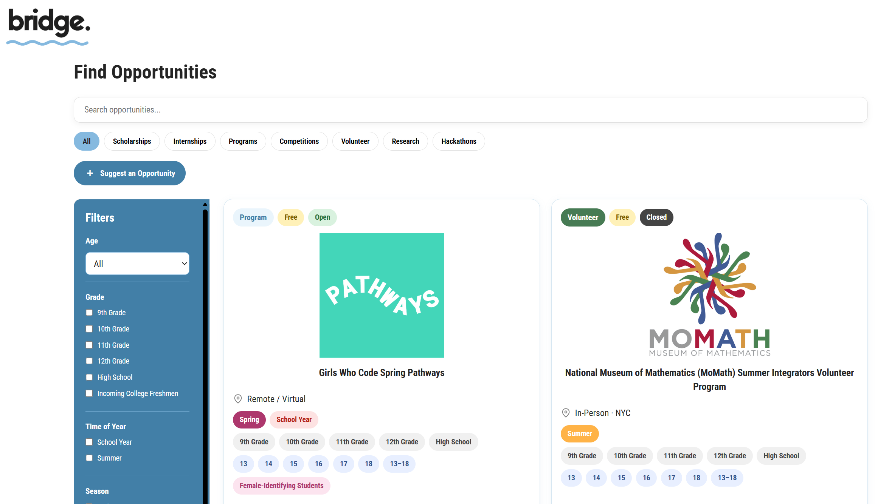

# Bridge

## About

A curated directory of opportunities for high school and early college students in the New York City area.

  

**Live Demo:** [https://bridge-v2-699i.onrender.com](https://bridge-v2-699i.onrender.com)

## Features

- Browse a card-based collection of scholarships, internships, academic programs, competitions, hackathons, volunteer opportunities, research opportunities, and more.
- Refine search results using filters for age, grade level, time of year, season, cost, location, application status, and gender eligibility.
- Submit suggestions for additional opportunities to be reviewed for inclusion on the platform.
- Manage opportunity listings through a password-protected admin dashboard, with the ability to add, edit, and delete entries.